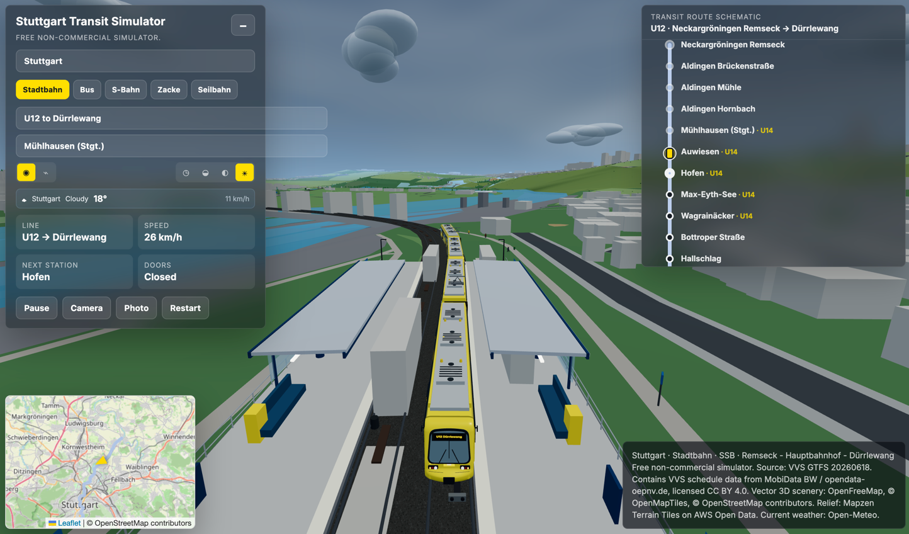
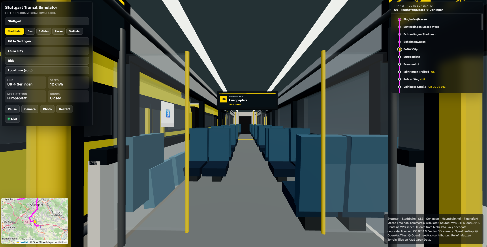
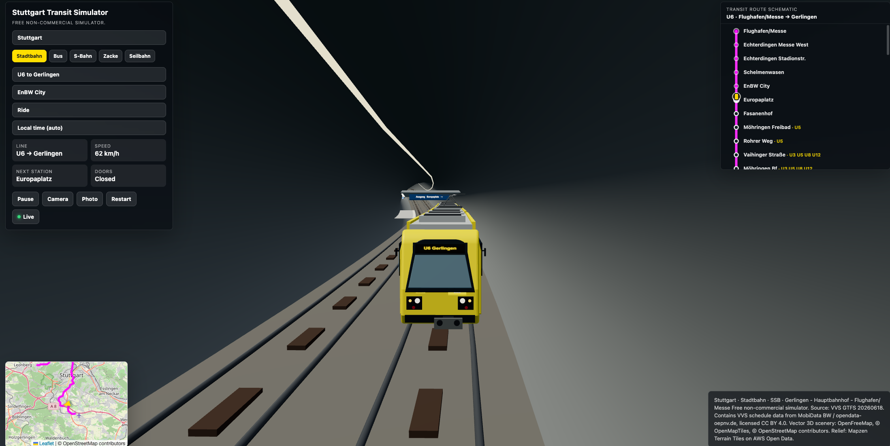
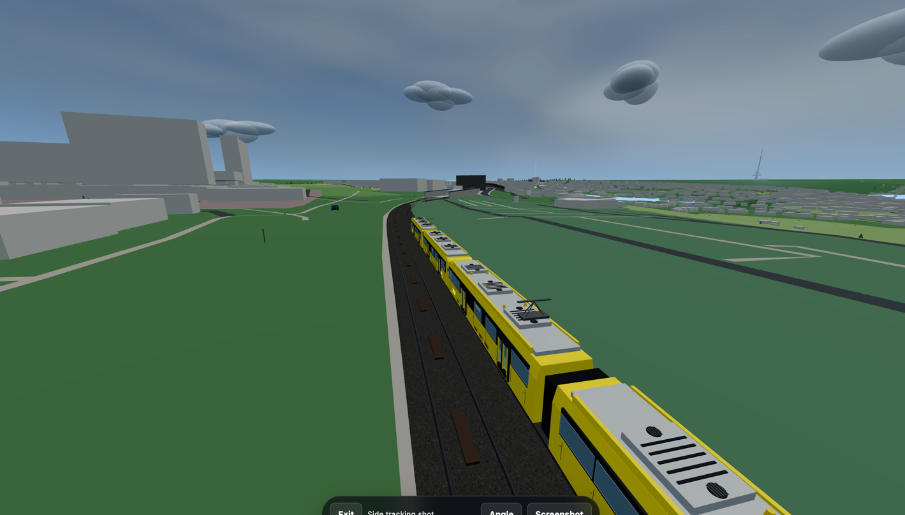
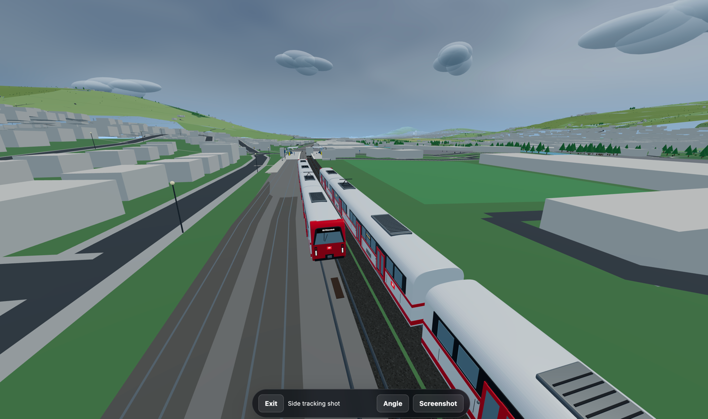
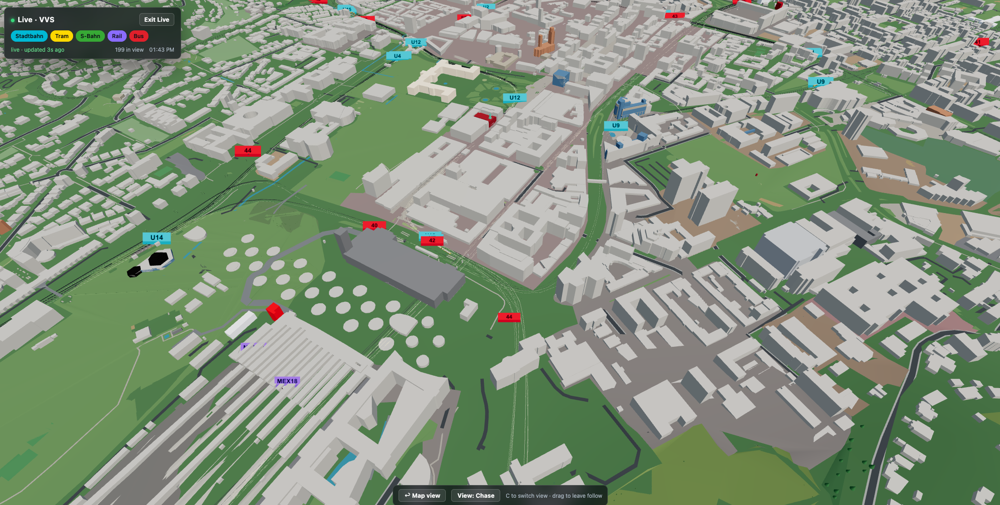
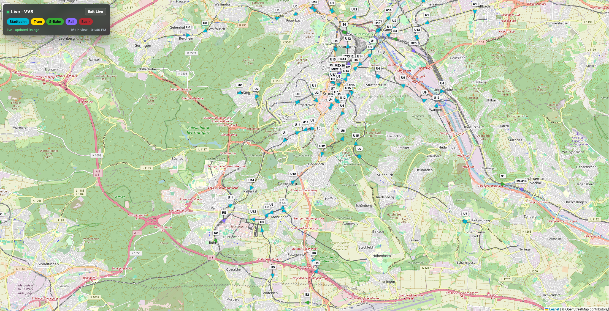
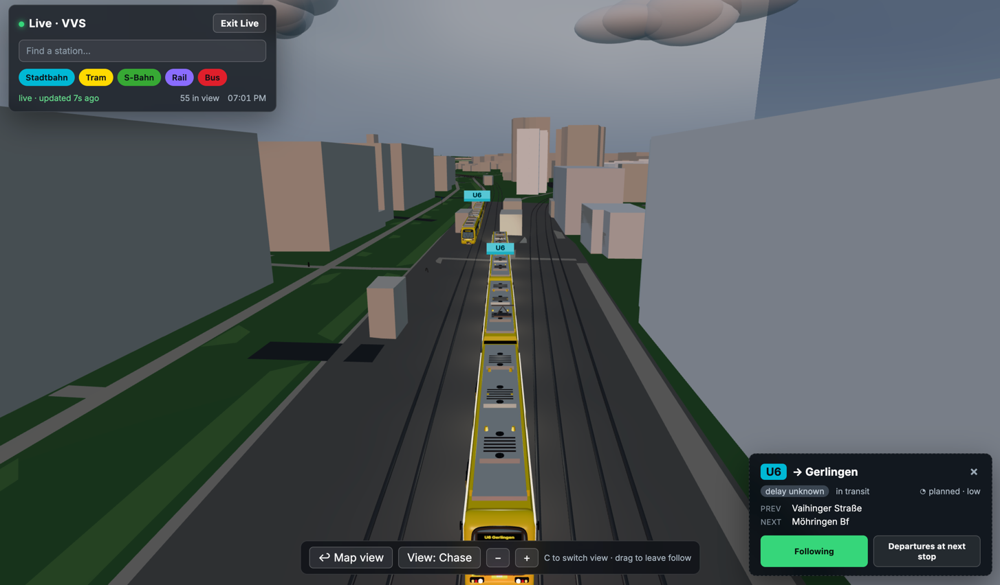
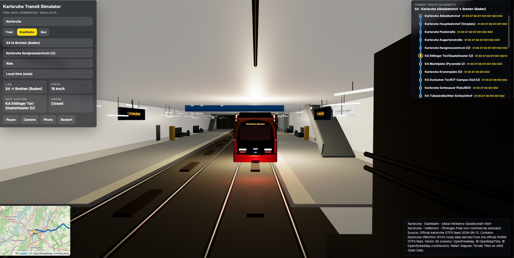
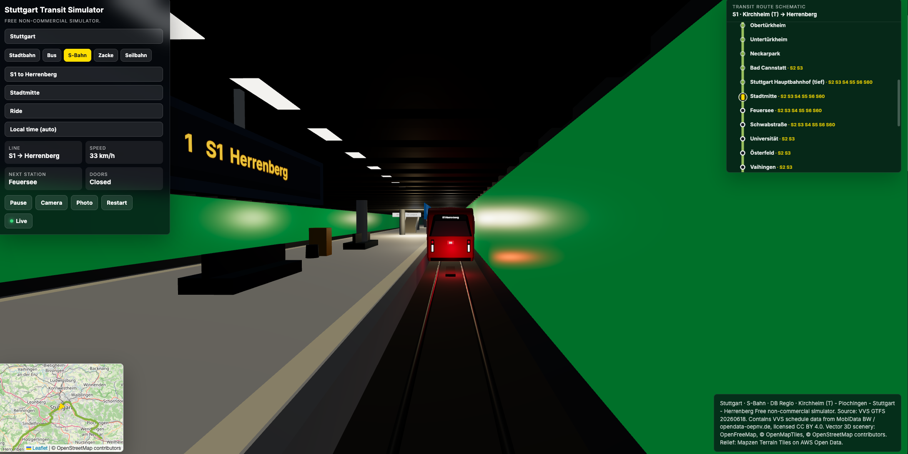

# Transit Simulator

Free, non-commercial browser prototype for public transport simulation, covering eleven city/network modules.

The app started as a Stuttgart-only prototype and is now structured as a multi-city platform: 
Stuttgart was the first city module rather than a hard-coded one-off. 

New cities are added through a city catalog entry, a city definition, and city-specific route manifests while reusing the shared renderer, simulator, HUD, minimap, and route diagram. 
Transport modes and vehicle families are defined per city, so each city can expose a different set of modes and map those 
modes onto different vehicle and guideway behaviors.


The repository currently includes eleven city modules:

- **Stuttgart** — Stadtbahn, bus, S-Bahn, Zacke and Seilbahn; also the only city with [live mode](#live-mode) (real-time VVS traffic)
- **Ulm/Neu-Ulm** — SWU tram lines 1 and 2 plus bus line 5
- **Odesa** — tram line 28, trolleybus line 7, and bus line 117
- **Zurich** — VBZ tram, bus, S-Bahn and funicular
- **Freiburg** — RVF tram, S-Bahn, bus and rail
- **Lviv** — tram and bus
- **Mexico City** — metro, tram, rail, Cablebús, trolleybus and bus
- **Baden-Württemberg Rail** — regional and inter-regional trains across the state
- **Wuppertal** — the Wuppertaler Schwebebahn suspended railway
- **Vancouver** — TransLink SkyTrain rapid transit
- **Karlsruhe** — AVG/KVV tram-train and Stadtbahn services

The app uses:

- **TypeScript + Three.js** for browser rendering
- **Leaflet** for the live minimap
- **Go + WebAssembly** for simulator state, station stops, dwell time, speed and braking logic
- **Vite** as the local dev server and bundler

## Screenshots

| | |
|---|---|
|  Chase-camera view of a Stadtbahn U12 service |  Passenger ride view |
|  Underground Stadtbahn tunnel section |  Photo mode |
|  S-Bahn service |  Live mode, 3D map |
|  Live mode, 2D top-down map |  Live mode, follow view |
|  Karlsruhe Kombilösung underground Stadtbahn station |  Stuttgart Stammstrecke underground S-Bahn station |

## Requirements

- Go 1.23+ with WebAssembly support
- Node.js 20+
- npm

## Run the built app without npm

The repository includes a refreshed `dist/` build. If dependencies are hard to install behind a proxy, serve the built app with Go:

```bash
go run ./tools/serve
```

Then open:

```text
http://127.0.0.1:5174
```

## Run locally

```bash
npm install
npm run dev
```

Then open the Vite URL printed in the terminal.

`npm run dev` starts Vite. Use `npm run build` to rebuild both Go/WASM and the production bundle.

## Build production bundle

```bash
npm run build
npm run preview
```

## Realtime API types

The realtime tools (journey/stop search, departures) call the
`transit-simulator-backend` TRIAS service. Its TypeScript contracts are
generated from the backend's OpenAPI spec, checked in at `api/openapi.yaml`.
After updating that spec, regenerate the types:

```bash
npm run gen:api
```

This rewrites `src/features/realtime/generated/api-types.ts` (do not edit it by
hand). `src/features/realtime/types.ts` renames those wire types to the app's
vocabulary. Set `VITE_REALTIME_API_BASE` (see `.env.example`) to the backend
URL; in dev Vite proxies `/api` there to sidestep CORS.

## Deploy to Vercel

The repository includes the generated Go WebAssembly runtime in `public/`, so Vercel only needs Node.js for its build:

```bash
npm run build:vercel
```

Import the repository into Vercel or run `vercel`. The checked-in `vercel.json` selects the Vite preset, runs the cloud-safe build command, publishes `dist/`, and serves `sim.wasm` with the WebAssembly MIME type. After changing the Go simulator, run `npm run wasm:build` and commit the refreshed `public/sim.wasm` and `public/wasm_exec.js` artifacts before deploying.

## Deploy with Docker

The multi-stage Docker build compiles the Go WebAssembly simulator and the Vite client, then serves the production files with Nginx:

```bash
docker build -t stuttgart-transit-simulator .
docker run -d \
  --name stuttgart-transit-simulator \
  --restart unless-stopped \
  -p 8080:8080 \
  stuttgart-transit-simulator
```

Open `http://your-server:8080`. The container exposes `/healthz` for Docker, reverse-proxy, and hosting-platform health checks. For a public deployment, place the container behind Caddy, Nginx, Traefik, or another HTTPS reverse proxy and forward traffic to port `8080`.

To update the deployment after pulling new code:

```bash
docker build -t stuttgart-transit-simulator .
docker rm -f stuttgart-transit-simulator
docker run -d \
  --name stuttgart-transit-simulator \
  --restart unless-stopped \
  -p 8080:8080 \
  stuttgart-transit-simulator
```

## Refresh VVS GTFS route packages

The app reads compact generated route packages from `public/data/vvs-stadtbahn-routes.json`.

```bash
mkdir -p data/raw
curl -L https://download.vvs.de/gtfs_realtime.zip -o data/raw/vvs-gtfs.zip
node tools/import-vvs-gtfs.mjs data/raw/vvs-gtfs.zip public/data/vvs-stadtbahn-routes.json
node tools/enrich-route-terrain.mjs
npm run build
```

The raw ZIP is intentionally ignored because it is large. The generated JSON includes attribution metadata. Current generated feed source: VVS GTFS `20260618`, valid from `20260618` to `20260918`.

## Project structure

```text
.
├── public/
│   ├── data/demo-route.json
│   ├── data/cities.json      # available cities and their route manifests
│   ├── sim.wasm              # generated
│   └── wasm_exec.js          # copied from Go toolchain
├── scripts/build-wasm.sh
├── src/
│   ├── main.ts               # app bootstrap and HUD
│   ├── cities/               # city catalog + per-city definitions
│   ├── domain/transport.ts   # transport-mode definitions, vehicle kinds and guideway profiles
│   ├── minimap.ts            # Leaflet map and vehicle marker
│   ├── osm-scene.ts          # streamed OSM buildings and surface objects
│   ├── route.ts              # route packages and geometry
│   ├── terrain.ts            # Terrarium DEM decoding and ground deformation
│   ├── wasm.ts               # Go/WASM loader and typed bridge
│   ├── world.ts              # Three.js world, train, stations
│   └── style.css
├── tools/import-vvs-gtfs.mjs # GTFS-to-route-package importer
├── tools/enrich-route-terrain.mjs # DEM profile and OSM tunnel enrichment
├── tools/serve/main.go       # no-npm static server for dist/
└── wasm/sim/
    ├── domain/types.go       # simulation entities
    ├── usecase/simulator.go  # ride/driver use cases
    └── main.go               # thin browser/WASM adapter
```

## Design note

The prototype keeps the simulation deterministic and compact: JavaScript requests one Go/WASM tick per animation frame, then renders the selected vehicle at the returned `distanceM`. The Go domain/use-case/adapter split keeps browser APIs out of simulation rules and leaves room for mode-specific operating behavior.

The WASM build script writes Go's build cache to `.cache/go-build`, keeping builds self-contained in restricted workspaces.

Real-world scenery uses OpenFreeMap's public OpenMapTiles-compatible vector tiles. Attribution: OpenFreeMap, © OpenMapTiles, data from © OpenStreetMap contributors.

Relief uses the open Mapzen Terrain Tiles dataset hosted through AWS Open Data. Route packages store a pre-generated smoothed terrain/rail profile; the visible ground remains untextured geometry rather than a photographic raster surface. Tunnel classification comes from the OpenMapTiles `transportation` layer's `brunnel=tunnel` geometry near each rail GTFS shape.

## License

Original project source code is licensed under the [MIT License](LICENSE).
Copyright (c) 2026 ownerofglory.

Third-party software, OpenStreetMap/OpenFreeMap data, Mapzen terrain data, and GTFS datasets retain their respective licences and attribution requirements; they are not relicensed under MIT. Preserve their notices and credits when reusing or distributing them.

The non-commercial description refers to this prototype. The MIT licence permits commercial reuse of the original project code.
